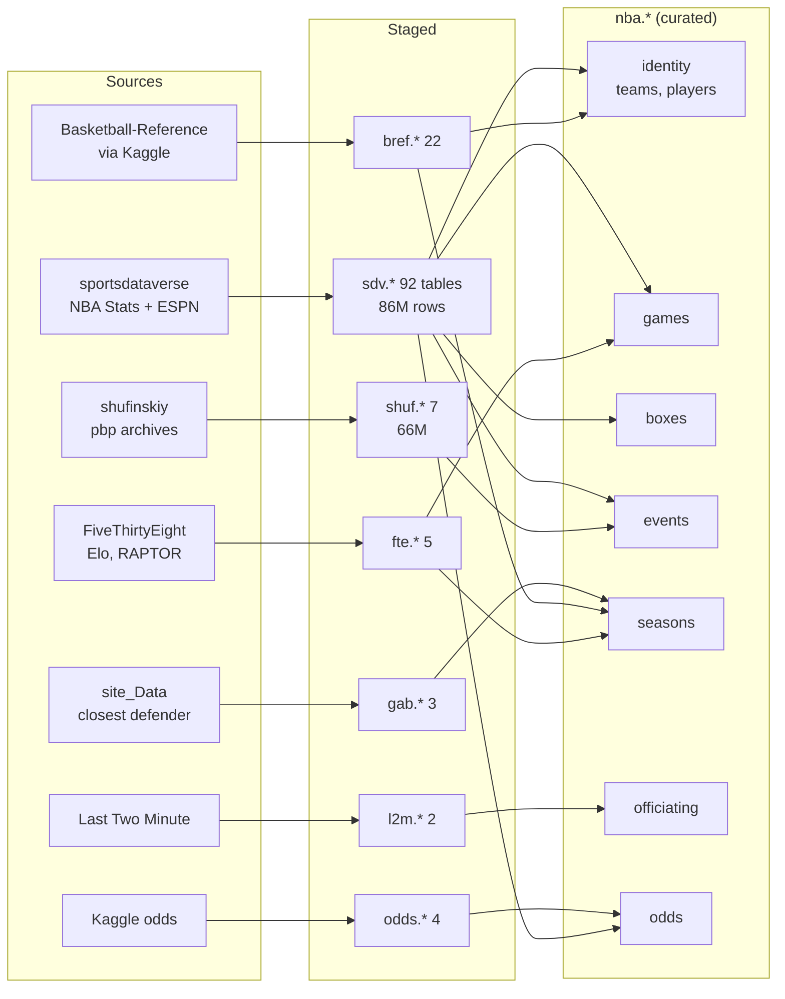
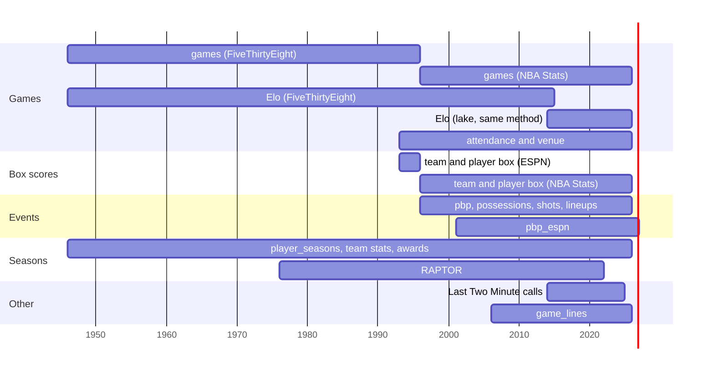
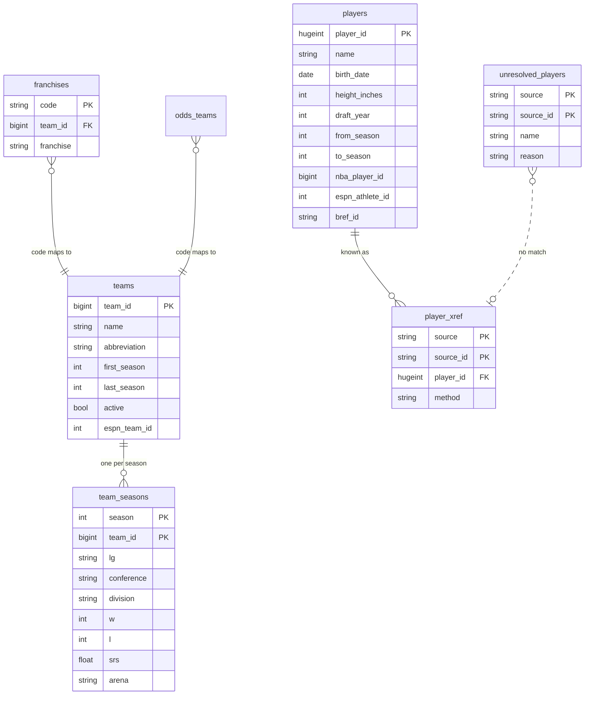
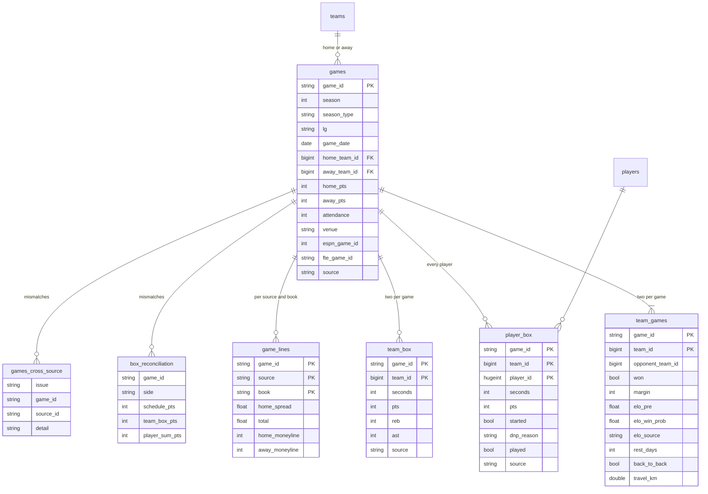
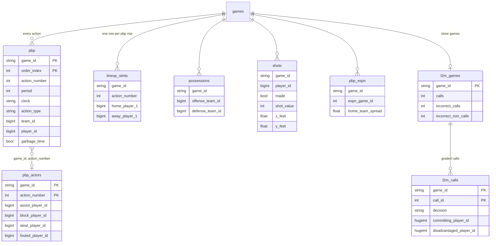
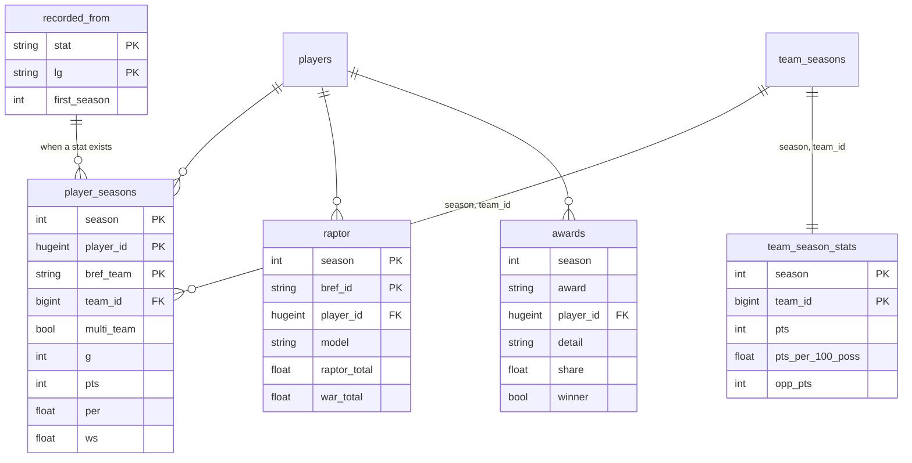

# Dataset guide

What the lake holds, how the tables fit together, and where each one is thin.
For every column see `docs/data-dictionary.md`. For how the pipeline works see
`ARCHITECTURE.md`. Numbers here were measured on 2026-10-22.

## At a glance

| | |
|---|---|
| Sources | 7 mirrors: sportsdataverse, shufinskiy, site_Data, FiveThirtyEight, Last Two Minute, Basketball-Reference via Kaggle, two Kaggle odds sets |
| Raw | 3,888 downloaded files, 6.6 GB, kept forever |
| Staged | 135 tables in 7 source schemas, about 153 million rows |
| Curated | 29 tables in `nba`, all on one set of ids, rebuilt and checked on every run |
| History | every game from 1946-47, box scores from 1993-94, play-by-play from 1996-97 |

The lake has two query surfaces. **Staged** tables (`sdv.*`, `bref.*`, ...)
keep each source's own columns and ids, one table per upstream file family.
**Curated** tables (`nba.*`) join those sources onto one identity model and
are the place to start. Most staged tables have no curated counterpart yet,
and those are listed at the end.



`shuf.*` overlaps `sdv` play-by-play and is kept as an independent second
copy. Two of its files feed curated tables. `pbp_actors` takes the assister
and the fouled player from v2, which NBA Stats v3 does not carry, and from
cdn.nba.com for 2025-26, after v2 ends. `pbp_qualifiers` takes cdn.nba.com's
qualifiers, descriptor, foul official, and wall clock. cdn events match v3
on game, action number, and period for all but 0.03 percent.

## Coverage by season

Season is the end year everywhere: 2016 means 2015-16.



Three eras follow from the sources:

- **1946-47 to 1992-93: results only.** Every game with score, date, and
  Elo, plus Basketball-Reference season totals per player and team. No
  per-game box scores exist for this era in any free source.
- **1993-94 to 1995-96: ESPN boxes.** Per-game box scores from ESPN, with
  attendance and venue. The weakest stretch: 34 team sides where player
  points miss the team total, and 1,758 player rows whose ESPN name did not
  resolve to a player.
- **1996-97 on: NBA Stats.** Box scores, play-by-play, possessions, shots, and
  lineups, nearly complete and reconciled to the schedule.

## Identity model

Every curated fact table joins on four keys:

| Key | Type | What it is |
|---|---|---|
| `game_id` | VARCHAR | NBA Stats id such as `0021500001` from 1996-97. Earlier games use the FiveThirtyEight id such as `194611010TRH`. A completed game NBA Stats has not published yet uses `espn` plus its ESPN id, such as `espn401909092`, until it does, and `game_xref` maps that id afterward (decision 28) |
| `team_id` | BIGINT | NBA Stats franchise id such as `1610612747`. Defunct franchises use `800000001` and up |
| `player_id` | HUGEINT | NBA Stats person id where one exists, else a minted id from `9000000000000` |
| `season` | INTEGER | End year of the season |

A franchise keeps one `team_id` through every move and rename, so the
Minneapolis and Los Angeles Lakers share `1610612747`. 2,552 of the 5,884
players carry a minted id, mostly players who retired before 1997, because
NBA Stats ids for them come only from sources that are out of scope.



`player_xref` records how each source id was matched, so a doubtful match can
be found and audited:

| Source | Method | Ids |
|---|---|---|
| nba | identity | 3,332 |
| bref | name | 2,819 |
| bref | minted (no NBA Stats id) | 2,552 |
| bref | team_season_name, name_tokens | 45 |
| espn | crosswalk | 2,521 |
| espn | name_span, name_birth_date | 518 |
| espn | nba_name_span (no bref slug, one NBA Stats namesake in span) | 35 |
| fte | bref_slug | 3,590 |

## Games and box scores



| Table | Grain | Rows | Seasons |
|---|---|---|---|
| `games` | game | 80,272 | 1947 to 2027 |
| `game_xref` | source game id, view | 187,426 | 1947 to 2027 |
| `team_games` | team per game, with Elo, rest, and travel | 160,544 | 1947 to 2027 |
| `team_elo` | team per competitive game, the lake's Elo | 30,990 | 2015 to 2027 |
| `team_box` | team per game | 83,142 | 1994 to 2027 |
| `player_box` | player per game, DNPs included | 1,128,499 | 1994 to 2027 |
| `game_inactives` | player listed inactive per game | 158,808 | 1997 to 2026 |
| `game_officials` | referee per game | 90,271 | 1997 to 2026 |
| `officials` | referee | 167 | 1997 to 2026 |
| `game_lines` | game, source, sportsbook | 174,372 | 2007 to 2026 |
| `box_reconciliation` | game side that disagrees | 6,091 | 1994 to 2027 |
| `games_cross_source` | game the sources disagree on | 243 | 1994 to 2026 |

`games` covers BAA (1947 to 1949), NBA (1950 on), and ABA (1968 to 1976), plus
preseason, playoffs, play-in, All-Star, and NBA Cup games, told apart by
`lg` and `season_type`. Filter `season_type = 'regular'` for standings
math. Minutes in both box tables are `seconds`. A completed game newer than
every NBA Stats game comes from ESPN with `source = 'espn'`, ESPN boxes, and
play-by-play in `pbp_espn` only, until NBA Stats publishes it (decision 28).

`game_inactives` is NBA Stats' inactive list for each game from 1996-97,
for with-and-without questions beside `on_off`. 37 listed players never
played a game, so 735 rows have no `players` row. `game_officials` names
the crew of each game from 1996-97, and `officials` has one row per
referee. Its crews match ESPN's by last name for 99.47 percent of officials
in the games both list.

`game_lines` has three sources. `kaggle_lines` gives one line per game from
2007-08, `kaggle_books` gives ten sportsbooks including Pinnacle for 2006-07
to 2017-18, and `espn` gives spreads only from 2012-13. `home_spread` is the
points added to the home score, so a negative value means the home team is
favored. Moneylines end in January 2023.

## Events



| Table | Kind | Rows | Seasons |
|---|---|---|---|
| `pbp` | table | 18,970,589 | 1997 to 2026 |
| `pbp_actors` | table | 3,822,559 | 1997 to 2026 |
| `pbp_qualifiers` | table | 4,312,866 | 2021 to 2026 |
| `lineup_stints` | view | 18,970,589 | 1997 to 2026 |
| `possessions` | view | 7,478,414 | 1997 to 2026 |
| `shots` | view | 6,335,778 | 1997 to 2026 |
| `pbp_espn` | view | 14,206,956 | 2002 to 2027 |
| `l2m_calls` | table | 90,302 | 2015 to 2025 |
| `l2m_games` | table | 4,487 | 2015 to 2025 |

The views read straight from staged tables, so they cost nothing to rebuild
and always match the latest stage. The tables are built by season or by game
and rebuilt only where their staged units changed. `lineup_stints` has one row per `pbp` row
but no `order_index`, so its `(game_id, action_number)` repeats on block and
steal rows. `pbp` carries the same moment's lineups as `off_player_1` to
`off_player_5` and `def_player_1` to `def_player_5`. `pbp.player_id` is NULL for team
events but also carries coach and referee ids. Possession points run about
1.5 per team-game below the box score before 2017-18, so use the box score
for scoring.

`pbp` carries the second player of each action from `pbp_actors`: the
assister on a make, the blocker on a miss, the stealer on a turnover, and
the fouled player on a foul. NBA Stats also writes each block and steal as
its own row with an empty `action_type` and the same `action_number` as the
miss or turnover, so `action_number` repeats. The actor columns sit on the
primary row only, so counting them counts each play once. Per player and
game they match the box score's assists, steals, and blocks on all but 148
of 1.04 million rows. Fouled players start in 2005-06, and assists and fouled
players are missing for 2026-27 on and for preseason, all-star, play-in, and
Cup final games, which neither v2 nor cdn.nba.com covers. Where both cover a
play they agree on 99.98 percent of assists and 99.80 percent of fouled
players.

From 2020-21 through 2025-26, `pbp` also carries cdn.nba.com's detail on
the primary row: the `qualifiers` list and its `fast_break`,
`second_chance`, `from_turnover`, and `points_in_paint` flags, the shot or
foul `descriptor` (pullup, turnaround fadeaway), the `official_id` who
called a foul, and the `wall_clock` time.

## Seasons



| Table | Grain | Rows | Seasons |
|---|---|---|---|
| `player_seasons` | player, league, season, team (113 columns) | 33,339 | 1947 to 2026 |
| `team_season_stats` | team season (84 columns) | 1,818 | 1947 to 2026 |
| `raptor` | player season per RAPTOR model | 23,844 | 1977 to 2022 |
| `player_impact` | player season and type, sportsdataverse RAPM, SPM, BPM, WAR, DARKO-style | 20,659 | 1997 to 2026 |
| `draft_combine` | prospect per combine, measurements and drills | 1,873 | 2001 to 2027 |
| `injuries` | player per daily ESPN injury snapshot, `injuries_latest` the newest | 3,856 | 2027, from 2026-09-08 |
| `depth_charts` | team, position, and rank per daily ESPN snapshot, `depth_charts_latest` the newest | 44,934 | 2027, from 2026-09-08 |
| `awards` | player per award, selection, or team | 7,745 | 1947 to 2026 |
| `player_season_dash` | player season and type, NBA Stats measures (111 columns) | 20,990 | 1997 to 2027 |
| `team_season_dash` | team season and type, NBA Stats measures (98 columns) | 1,400 | 1997 to 2027 |
| `player_season_tracking` | player season and type, tracking (154 columns) | 10,081 | 2014 to 2027 |
| `player_season_hustle` | player season and type, hustle | 8,579 | 2016 to 2027 |
| `team_season_hustle` | team season and type, hustle | 534 | 2016 to 2027 |
| `player_season_closest_defender` | player season, type, and closest defender band | 37,349 | 2014 to 2027 |
| `team_season_closest_defender` | team season, type, side, and closest defender band | 5,024 | 2014 to 2027 |
| `player_season_play_types` | player, team, side, and Synergy play type per season | 88,523 | 2016 to 2026 |
| `matchups_game` | offensive player against defender per game | 2,167,502 | 2018 to 2026 |
| `matchups_season` | offensive player against defender per regular season | 1,224,973 | 2018 to 2026 |
| `recorded_from` | stat per league | 30 | |

A player traded mid-season has a `2TM` or `3TM` total row with `multi_team`
true and no `team_id`, plus one row per team. Sum the per-team rows or take
the total row, never both. `recorded_from` says when a stat began: offensive
rebounds from 1973-74 in the NBA, for example, so a NULL before then means
not recorded, not zero.

The NBA Stats season tables follow decision 23: `season_type` is `regular`
or `playoffs`, totals only, no rank columns. `player_season_dash` and
`player_season_tracking` keep one row per player season on the team the
player ended it with, `last_team_id`, so Tobias Harris's 2018-19 reads PHI
with 82 games. `team_count` says how many teams he played for. Their points
match `player_seasons` within 2 for all but 5 of 14,569 regular seasons.
Tracking starts in 2013-14. `player_impact` holds sportsdataverse's own
models, reimplemented in hoopR, so its BPM is close to but not
Basketball-Reference's and its DARKO columns are a forecast of the next
season, not the published DARKO. `draft_combine` labels each combine with
the rookie season it leads into, so the May 2003 combine is 2004, and its
`played` column marks the 1,263 prospects who reached the NBA. Hustle and Synergy start in 2015-16, and
Synergy keeps a row per team for a traded player. Matchups start in
2017-18: `matchups_game` agrees with the independent `shuf.matchups` copy
on partial possessions for all but 0.11 percent of pairs.

## Staged-only data

These staged tables have no curated model. They keep their source ids and
join to curated tables through `nba.players.nba_player_id`,
`nba.games.espn_game_id`, or the NBA Stats `game_id` directly.

| Staged tables | What | Seasons |
|---|---|---|
| `sdv.leaguedash_lineups_*`, `sdv.nba_stats_lineups` | five-man lineup season stats | 2008 on |
| `sdv.leaguedash_player_master`, `sdv.leaguedash_team_master` | wide master copies of the dashboards in `player_season_dash` and `team_season_dash` | 1997 on |
| `sdv.leaguedash_standings`, `sdv.nba_stats_standings`, `sdv.espn_nba_standings` | standings | 1996 on, ESPN 2002 on |
| `sdv.nba_stats_player_season_stats`, `sdv.nba_stats_team_season_stats` | NBA Stats season stats by measure type | 1997 to 2026 |
| `sdv.nba_stats_player_game_logs` | team game logs, despite the name | 1997 to 2026 |
| `sdv.nba_stats_rolling_windows`, `sdv.nba_stats_metric_curves` | sportsdataverse rolling-window and metric-curve model outputs | 1997 to 2026 |
| `sdv.matchups_rollup` | season matchups rolled up by defender position | 2018 on |
| `sdv.nba_stats_draft`, `sdv.espn_nba_draft`, `bref.draft_pick_history` | draft picks | 1947 on for bref |
| `sdv.nba_stats_coaches`, `sdv.nba_stats_rosters`, `sdv.espn_nba_rosters` | coaches and season rosters | 1997 on, ESPN recent seasons |
| `sdv.espn_nba_shots`, `sdv.espn_nba_player_season_stats`, `sdv.espn_nba_team_season_stats` | ESPN shots and season stats | 2002 on, player stats 1994 on |
| `sdv.espn_nba_schedules`, `sdv.espn_nba_games_in_data_repo` | ESPN schedules and coverage flags | 1994 on and 2002 on |
| `sdv.espn_nba_officials` | ESPN's referees, the cross-check for `game_officials` | 2002 on |
| `sdv.nba_groups`, `sdv.nba_group_aliases`, `sdv.nba_group_seasons`, `sdv.nba_team_group_seasons_all` | sportsdataverse's franchise groupings | 1971 on |
| `bref.player_per_game`, `bref.player_per_36`, `bref.team_per_game`, `bref.opponent_per_game` | Basketball-Reference rates beside the totals curated in `player_seasons` and `team_season_stats` | 1947 on |
| `bref.team_abbrev`, `bref.end_of_season_teams_voting` | team abbreviations and All-League voting | 1947 on, voting 1963 on |
| `fte.raptor_team_*` | RAPTOR team ratings | 1977 to 2022 |
| `shuf.nbastatsv3`, `shuf.datanba`, `shuf.pbpstats`, `shuf.shotdetail` | second copies of play-by-play and shots | 1997 on |
| `shuf.matchups` | a second copy of box score matchups, the cross-check for `matchups_game` | 2018 to 2026 |

## Quality

Measured against the lake, not taken from the sources' own claims:

- **Results are complete.** Every team season since 1968 has the right
  number of games, ABA included. The 2016 Finals game 7 reads 89 to 93 with
  attendance 19,596.
- **NBA Stats boxes from 1996-97 are nearly clean.** Player points miss the
  team total on 2 sides in 30 seasons.
- **ESPN boxes for 1993-94 to 1995-96 are the weak stretch.** 34 sides miss
  the team total by 2 to 14 points, and 72 ESPN and FiveThirtyEight ids are
  unresolved, mostly name variants such as Tyrone Bogues.
- **Lines agree across sources.** Favorites win 68 to 69 percent of games in
  every source, and `kaggle_lines` is within a point of ESPN on 95.6 percent
  of shared games and of Pinnacle on 99.4 percent.
- **Every disagreement is published.** `box_reconciliation`,
  `games_cross_source`, and `unresolved_players` list each one, and 61 gates
  block a curate whose error rate passes the threshold in the gate's name.

Known gaps: NBA Stats marks starters only from 2017-18, so ESPN game rosters
fill `player_box.started` for 2001-02 to 2016-17 where ESPN lists five
starters for a team (98.6 percent of team games, `started_source` says
which), and 1996-97 to 2000-01 have no starters. Play-by-play names the
fouled player only from 2005-06, RAPTOR stops at 2021-22, moneylines stop
in January 2023, and the per-sportsbook odds set lists its license as
unknown. FiveThirtyEight Elo stops at 2014-15, and `team_elo` continues it
with their method and with a calibrated fitted home edge (decision 26).

## Example queries

```sql
-- A team's regular season, game by game, with rest and Elo
select game_date, opponent_team_id, won, margin, rest_days, elo_pre
from nba.team_games
where team_id = 1610612744 and season = 2015 and season_type = 'regular'
order by game_date;

-- A player's career box scores
select g.game_date, b.pts, b.reb, b.ast, b.seconds / 60 as minutes
from nba.player_box b join nba.games g using (game_id)
join nba.players p using (player_id)
where p.name = 'Stephen Curry' and b.played order by g.game_date;

-- Against the spread, home teams, one line per game
select g.season, avg((g.home_pts - g.away_pts + l.home_spread > 0)::int) as home_cover_rate
from nba.game_lines l join nba.games g using (game_id)
where l.source = 'kaggle_lines' group by 1 order by 1;

-- Shot chart for one player in one season
select x_feet, y_feet, made, shot_value from nba.shots
where player_id = 201939 and season = 2016;
```
